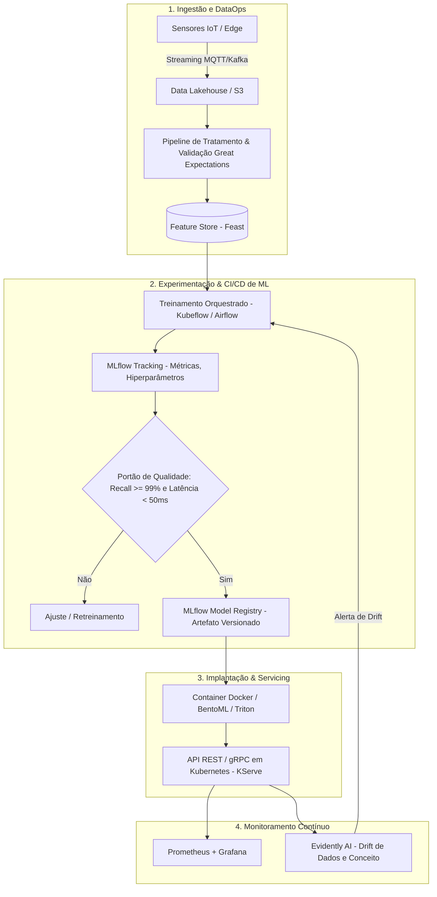
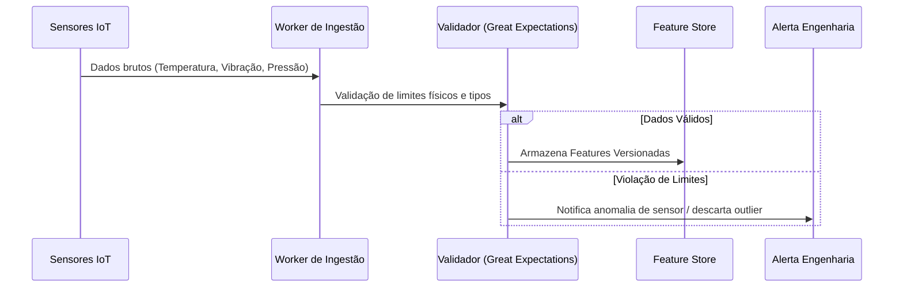
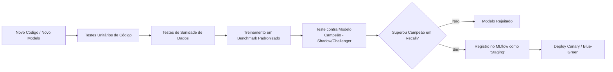
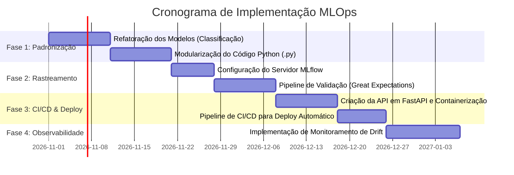

# Plano de Operação para Machine Learning (MLOps Plan)
**Projeto:** Manutenção Preditiva Industrial & Visão Computacional  
**Dataset Base:** Telemetria de Sensores (`dados_sensores_metaltech.csv` / `dados_limpos.csv`)  
**Target:** `Falha_motor` (Classificação Binária de Falhas Críticas)

---

## 1. Sumário Executivo & Diagnóstico do Estado Atual

Atualmente, o pipeline de Machine Learning opera em regime manual e ad-hoc baseado em Jupyter Notebooks:
* Limpeza de dados com imputação estática por mediana via scripts pontuais.
* Formulação incorreta de regressão (`LinearRegression`, `RandomForestRegressor`) para variável-alvo discreta/binária (`Falha_motor`), com posterior corte artificial em threshold de $0.5$.
* Treinamento e avaliação isolados em ambiente local (máquinas de desenvolvedor).
* Persistência de modelo por `joblib` sem rastreamento de linhagem de dados, metadados de experimentos, hiperparâmetros ou versionamento de artefatos.

### Diagnóstico Comparativo dos Modelos Atuais

| Modelo | $R^2$ Original | Acurácia | Precisão | Recall | F1-Score | Diagnóstico Operacional |
| :--- | :---: | :---: | :---: | :---: | :---: | :--- |
| **Regressão Linear** | $0.22\%$ | $95.10\%$ | $0.00\%$ | $0.00\%$ | $0.00\%$ | **Inoperante.** Acurácia enganosa devido ao desbalanceamento de classes; previu zero falhas. |
| **Random Forest** | $98.61\%$ | $99.95\%$ | $98.99\%$ | $100.00\%$ | $99.49\%$ | **Apto.** Capturou não-linearidades e interações entre vibração, pressão e temperatura. Deve ser migrado para `RandomForestClassifier`. |

---

## 2. Arquitetura do Ciclo de Vida MLOps (End-to-End)

---

## 3. Os 5 Pilares Operacionais Estruturados

### Pilar 1: Alimentação, Limpeza Automatizada e Qualidade de Dados (DataOps)
Substituir o tratamento manual de planilhas por contratos de dados e pipelines automatizados.

1. **Ingestão Padronizada:**
   * Ingestão contínua de telemetria das máquinas (`Id_Maquina`, `Temperatura_C`, `Vibracao_mms`, `Pressao_bar`, `Data/Hora`).
   * Armazenamento particionado por máquina e data em formato colunar otimizado (Parquet/Delta Lake).
2. **Data Quality & Validação de Schemas:**
   * Implementação de suite de testes automatizados com ferramentas como **Great Expectations**:
     * $50.0 \le \text{Temperatura\_C} \le 85.0$
     * $1.0 \le \text{Vibracao\_mms} \le 10.0$
     * $20.0 \le \text{Pressao\_bar} \le 60.0$
   * Valores nulos ou anômalos (outliers instrumentais causados por ruído de sensor) tratados dinamicamente via estimadores probabilísticos por máquina, e não por mediana global estática.
3. **Feature Store:** Centralização do catálogo de features com controle de versão para garantir consistência temporal entre treino e inferência em tempo real.

---

### Pilar 2: Governança, Políticas e Restrições de Métricas

Para manutenção preditiva crítica e controle de maquinário, o custo do **Falso Negativo (deixar um motor falhar)** é ordens de grandeza maior que o de um **Falso Positivo (falsa parada para inspeção)**.

1. **Métrica-Chave de Decisão (SLO do Modelo):**
   * **Recall (Sensibilidade) $\ge 99.0\%$** na classe de falha.
   * **F1-Score ponderado $\ge 98.0\%$**.
   * Rejeição obrigatória da métrica de acurácia isolada como critério de aceite (devido à raridade de falhas industriais).
2. **Definição de Threshold Dinâmico de Alerta:**
   * Alerta Amarelo (Atenção / Pré-falha): Probabilidade prevista $\ge 0.30$.
   * Alerta Vermelho (Parada de Emergência): Probabilidade prevista $\ge 0.50$.
3. **Governança e Rastreabilidade Regulatória:**
   * Conformidade com normas de segurança funcional industrial (ex.: ISO 13849 / ISO 10816 para vibração mecânica).
   * Registro auditável de quem aprovou a promoção de cada modelo para produção.

---

### Pilar 3: Treinamento Contínuo e Automação de Pipeline (CT)

Substituir o script manual do Jupyter por pipelines modulares de orquestração (via **Kubeflow Pipelines** ou **Apache Airflow**).

1. **Adequação Metodológica do Algoritmo:**
   * Migração imediata da regressão linear para classificadores supervisionados com suporte a desbalanceamento (`RandomForestClassifier(class_weight='balanced')`, `XGBoostClassifier` ou `LightGBM`).
2. **Divisão Estratégica dos Dados:**
   * Substituição do `train_test_split(random_state=42)` puramente aleatório por **Split Temporal ou Agrupado por Máquina** (`TimeSeriesSplit` ou `GroupKFold` pelo `Id_Maquina`), evitando vazamento de dados (*data leakage*) entre leituras consecutivas minuto a minuto.
3. **Automação de Retreinamento:**
   * Retreinamento disparado por:
     * Agendamento periódico (ex.: semanal).
     * Gatilho de eventos (detecção de novos modos de falha rotulados pela manutenção).
     * Degradação de métricas de monitoramento.

---

### Pilar 4: Execução de Testes e Portão de Validação (CI/CD para ML)

Nenhum modelo entra em produção diretamente pelo notebook; ele deve cumprir os critérios do pipeline de Integração Contínua (CI):

1. **Validação Arbitrária Pré-Deploy:**
   * **Teste de Stress/Robustez:** Introdução de ruído gaussiano sintético nos dados de entrada para medir estabilidade das predições.
   * **Teste de Latência:** Inferência com $P_{99} \le 50\text{ ms}$ por predição unitária.
   * **Teste Cego (Hold-out permanente):** Avaliação em dados de máquinas não vistas durante o treino.

---

### Pilar 5: Ciclo Fechado de Observabilidade e Drift (MonitorOps)

Após a publicação da API do modelo, inicia-se o monitoramento contínuo da saúde das predições e dos sensores.

1. **Detecção de Data Drift (Deriva de Dados):**
   * Monitoramento contínuo das distribuições de `Temperatura_C`, `Vibracao_mms` e `Pressao_bar` usando testes estatísticos (Kolmogorov-Smirnov e PSI - Population Stability Index).
2. **Detecção de Concept Drift (Deriva de Conceito):**
   * Variação do desgaste natural do maquinário ao longo dos anos, alterando o padrão físico anterior a uma quebra mecânica.
3. **Circuito de Feedback:**
   * Integração com as ordens de serviço (OS) do time de manutenção mecânica para validar se a predição de falha do modelo foi confirmada em campo, gerando novos dados anotados para o próximo ciclo de retreinamento.

---

## 4. Stack Tecnológica Recomendada

| Camada | Ferramenta Recomendada | Função no Projeto |
| :--- | :--- | :--- |
| **Rastreamento e Registro** | **MLflow** | Versionamento de parâmetros, métricas e pesos de modelos. |
| **Qualidade de Dados** | **Great Expectations** | Verificação de integridade dos sensores na entrada. |
| **Orquestração de Pipeline** | **Apache Airflow** ou **Prefect** | Execução automática de ingestão, pré-processamento e treino. |
| **Serviço de Inferência** | **FastAPI** + **Docker** / **Triton** | Exposição de endpoints de inferência em alta disponibilidade. |
| **Monitoramento e Alertas** | **Evidently AI** + **Prometheus** | Detecção de desvios estatísticos de telemetria e degradação do modelo. |

---

## 5. Cronograma de Transição: Do Notebook para Produção

